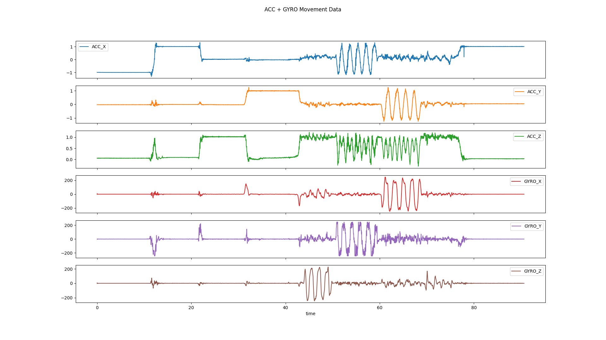
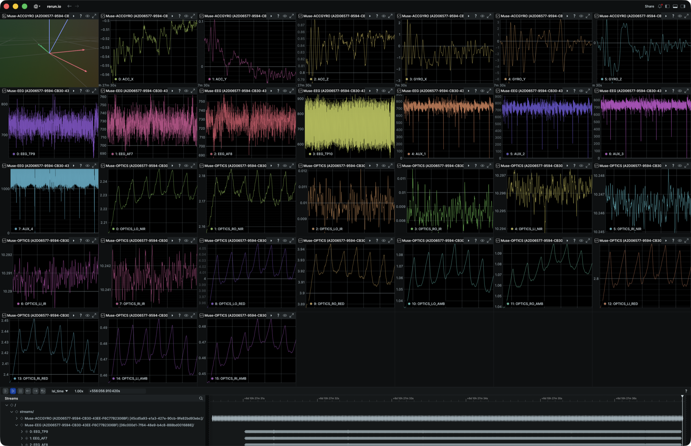
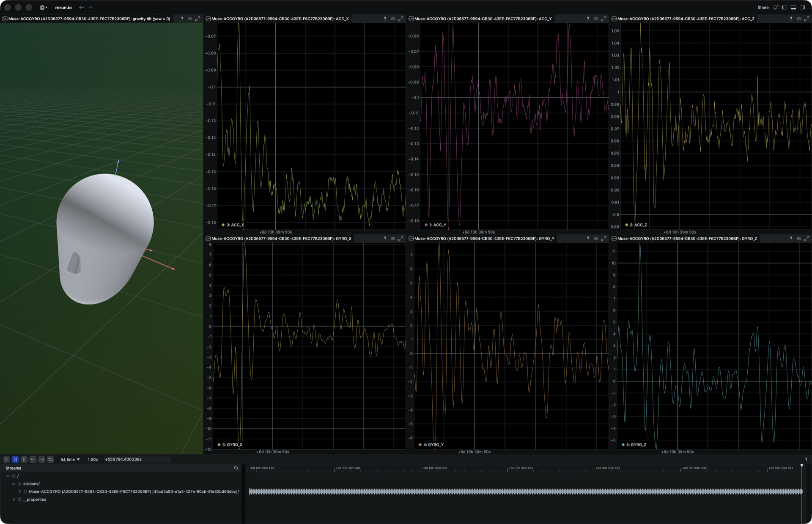

# OpenMuse

*The Open Python Muse S Athena EEG Decoder*

[](https://github.com/DominiqueMakowski/OpenMuse/actions/workflows/ci.yml)
[](https://eu.choosemuse.com/products/muse-s-athena)


This software allows recording, streaming via LSL and visualizing signals from the **Muse S Athena** headband.

> [!WARNING]  
> OpenMuse is NOT an official product of InteraXon Inc and is not affiliated with or endorsed by the company. It does not come with any warranty and should be considered an experimental software developed for research purposes only.

## Roadmap

- [x] Record raw data to a file
- [x] Decode raw data into a pandas DataFrame
- [x] Stream data over LSL
- [x] Visualise live LSL streams
- [x] Stream in battery signal and display battery level in visualizer
- [ ] Consider adding a visualization of the PSD of each signal
- [ ] Validate timestamping accuracy experimentally: confirm we get time-locked ERPs
- [ ] Validate the best PPG signal extraction method
- [ ] Validate fNIRS signal extraction method

## Installation

The recommended way is with [uv](https://docs.astral.sh/uv/), which installs `OpenMuse` as an isolated command-line tool (and fetches a suitable Python if needed):

```powershell
uv tool install git+https://github.com/DominiqueMakowski/OpenMuse
```

Or run it once without installing:

```powershell
uvx --from git+https://github.com/DominiqueMakowski/OpenMuse OpenMuse find
```

For development, clone the repository and use the locked environment:

```powershell
uv sync
uv run OpenMuse --help
uv run pytest
```

Installing with pip still works:

```powershell
pip install https://github.com/DominiqueMakowski/OpenMuse/zipball/main
```

## Usage

After installing the package, open a terminal and use the following commands:

### Find Muse devices

Power up the Muse S Athena headband (a blue light should appear on the front) and run:

```powershell
OpenMuse find
```

This will print the MAC addresses of nearby Muse devices. Note the address of your device for the next steps.


### Record data to a file

```powershell
OpenMuse record --address <your-muse-address> --duration 60 --outfile data.txt
```

> [!TIP]
> By default, recording and streaming use the `--preset p1041`, which enables all channels. You can change the preset using the `--preset` argument (see below for the list of documented presets).

#### Loading Recorded Data

Once your file is recorded, you can load it in Python using:

```python
import pandas as pd
import OpenMuse 

with open("data.txt", "r", encoding="utf-8") as f:
    messages = f.readlines()
data = OpenMuse.decode_rawdata(messages)

# Plot Movement Data
data["ACCGYRO"].plot(
    x="time",
    y=["ACC_X", "ACC_Y", "ACC_Z", "GYRO_X", "GYRO_Y", "GYRO_Z"],
    subplots=True
)
```



### Lab Streaming Layer (LSL)

> [!NOTE]  
> OpenMuse uses [MNE-LSL](https://mne.tools/mne-lsl/), an improved python-binding for the Lab Streaming Layer C++ library, `mne_lsl.lsl`, replacing `pylsl`.

To stream data over LSL, use:

```powershell
OpenMuse stream --address <your-muse-address>
```

This creates **separate LSL streams** for groups of channels (`Muse_EEG`,  `Muse_ACCGYRO`, etc.).

The following options are available:
- `--address`: The MAC address of your Muse device (required)
- `--duration`: Duration of the recording in seconds (if not specified, streaming will continue until you press Ctrl+C in the terminal)
- `--preset`: Preset configuration (default: `p1041` for all channels)
- `--record`: Record raw BLE packets to a file (optional)

### Visualize Live Streams

To visualize live LSL streams, open a new terminal (while the streaming is running) and run:

```powershell
OpenMuse view
```

### Visualize Live Streams with Rerun

Rerun is included in the standard installation. In a development checkout:

```sh
uv sync
```

The locked Rerun SDK (0.29.2) provides wheels for Apple Silicon macOS,
64-bit Linux x86_64/aarch64 (glibc 2.28+), and Windows x86_64; it has no source
distribution. Since Rerun is a standard dependency in this fork, installation
requires a supported platform. Intel macOS and 32-bit Raspberry Pi OS are not
supported by this dependency set.

Keep `OpenMuse stream` running in another terminal, then start the viewer:

```sh
uv run OpenMuse view-rerun
# Sensor-specific layouts:
uv run OpenMuse view-rerun --layout eeg
uv run OpenMuse view-rerun --layout accgyro
uv run OpenMuse view-rerun --layout optics
# Filter by stream name and exact channel labels:
uv run OpenMuse view-rerun --stream-name EEG --channels EEG_TP9 EEG_AF7
# Optionally filter by Muse device ID:
uv run OpenMuse view-rerun --address <your-muse-address>
```



For a standalone installation, use the installation instructions above and run
`OpenMuse view-rerun` in the activated environment.

`--layout` selects `all` (default, automatic grid), `eeg` (4 columns),
`accgyro` (3 columns), or `optics` (4 columns). Each sensor preset displays all
channels from its matching LSL streams. Layout selection combines with
`--address`, `--stream-name`, and `--channels`; only channels matching every
specified filter are displayed. Layout names are case-insensitive.

The `all` and `accgyro` layouts automatically include a 3D head model and
coordinate frames whenever a matching ACCGYRO stream is available:

```sh
uv run OpenMuse view-rerun --layout accgyro
```



In the `all` layout, each 3D pose pane occupies one grid tile, the same size as a
signal plot. In the `accgyro` layout, the 3D pane uses the left quarter of the
viewport and signal plots use the remaining three quarters.
Pose display requires a matching ACCGYRO stream with `ACC_X`,
`ACC_Y`, and `ACC_Z` labels. The smaller fixed axes are the reference frame;
the larger axes show the head-local frame. Red/green/blue indicate X/Y/Z.
The model uses +X toward the wearer's left, +Y backward, and +Z upward;
its face points toward −Y. Left/right refer to the wearer, not the screen.

Using the [Muse gravity convention](https://siddhantattavar.com/libmuse/enumcom_1_1choosemuse_1_1libmuse_1_1_accelerometer.html),
positive `ACC_X` indicates nodding down, positive `ACC_Y` indicates tilting
toward the wearer's right, and `ACC_Z` is +1 g when level. Before computing
roll/pitch, the viewer converts gravity to head-local up as
`(ACC_Y, ACC_X, ACC_Z)` and aligns that vector with reference +Z.
Yaw is fixed to zero, with no translation or gyro integration.

There is no startup zeroing or mounting-angle correction: `(0, 0, 1)` gives an
upright model, while nonzero horizontal gravity components remain visible even
when stationary. This is a gravity-based debugging estimate, not ROS TF,
calibrated head pose, or a full attitude estimator. Motion acceleration distorts
the estimate. Zero or non-finite acceleration hides the head model and sensor
axes until valid data returns.

Transforms use `lsl_time` and are included when `--save` is specified. Channel
filters affect the scalar plots; tilt still uses all three acceleration channels.

The bundled head model is derived from `OpenMuse/assets/head.step`; the viewer
loads `head.glb` without requiring CAD software. The STEP surface was tessellated
with Gmsh (1.5–3 mm mesh size), centered on its mesh bounding box, and uniformly
scaled to a height of 1.6 viewer units. The model keeps +Z up and its face toward
−Y. This is a visualization convention, not a measured sensor-to-head calibration.
The model is embedded in `.rrd` recordings, so replay does not need the source STEP
or an external model file.

Each selected channel starts in its own time-series pane. Use Rerun's Blueprint
panel to rearrange panes, select signals, or combine series in a view. Without
filters, all discovered `Muse-` streams (including multiple devices) are shown.
At each launch, the command activates a fresh grid for the selected channels,
replacing any layout Rerun restored from an earlier session.
The left Blueprint sidebar and right Selection sidebar start collapsed; use the
top-right panel toggles to reopen them. The bottom timeline remains available.
Streams are discovered once at startup; restart the command to discover new ones.
Press Ctrl+C in the terminal to stop receiving.

Values are logged without the original viewer's interpolation, DC removal, or
normalization. The `lsl_time` timeline preserves the incoming LSL timestamps
without inlet clock correction or smoothing. It is the publisher's LSL clock,
not UTC; this viewer does not establish cross-machine clock synchronization or
recover information already lost upstream in decoding.

Save the received data for inspection in Rerun:

```sh
uv run OpenMuse view-rerun --save debug.rrd
# Record for 30 seconds without opening a GUI:
uv run OpenMuse view-rerun --save debug.rrd --no-spawn --duration 30
uv run rerun debug.rrd
```

The Rerun recording contains the selected received channels, not raw BLE packets
or a lossless acquisition archive. This command does not connect to BLE itself
and does not require ROS 2.

### Hyperscanning (Multiple Devices Streaming)

To record from multiple Muse devices simultaneously (e.g., for hyperscanning studies):

1. **Discover devices**: Power on all Muse headbands and run `OpenMuse find` to note down each device's MAC address.

2. **Start streaming**: You can stream from multiple devices simultaneously by passing multiple MAC addresses:

```powershell
OpenMuse stream --address 00:55:DA:B9:FA:20 00:55:DA:BB:CD:CD
```

This will manage all connections in parallel within a single process. LSL streams will be named with their respective device IDs (e.g., `Muse-EEG (MAC1)`), allowing you to distinguish them on the receiving end.

3. **Visualize (optional)**: When multiple devices are streaming, the viewer will automatically detect and display streams from only the first device by default to avoid confusion. To view a specific device, use the `--address` filter:

```powershell
# View first device
OpenMuse view --address 00:55:DA:B9:FA:20

# View second device (open in a separate terminal)
OpenMuse view --address 00:55:DA:BB:CD:CD
```

> [!NOTE]
> If you run `OpenMuse view` without the `--address` argument when multiple devices are streaming, it will automatically select the first detected device and display a warning message listing all available devices.

4. **Record with LabRecorder**: Use [LabRecorder](https://github.com/labstreaminglayer/App-LabRecorder) to record all streams to an XDF file. Select all the streams from your devices (e.g., `Muse-EEG (00:55:DA:B9:FA:20)`, `Muse-EEG (00:55:DA:BB:CD:CD)`, etc.).

#### Multi-Device Raw Recording (Alternative to LSL)

You can also do raw BLE packet recordings from multiple Muse devices simultaneously by passing multiple MAC addresses:

```powershell
OpenMuse record --address 00:55:DA:B9:FA:20 00:55:DA:BB:CD:CD --duration 60 --outfile data.txt
```

When recording from multiple devices, the device address will be automatically appended to the filename to avoid collisions (e.g., `data_0055DAB9FA20.txt`, `data_0055DABBCDCD.txt`).

## Technical Details

### Specs

Muse S Athena specs (From the [Muse website](https://eu.choosemuse.com/products/muse-s-athena)):
- Wireless Connection: BLE 5.3, 2.4 GHz
- EEG Channels: 4 EEG channels (TP9, AF7, AF8, TP10) + 4 amplified Aux channels
  - Sample Rate: 256 Hz
  - Sample Resolution: 14 bits / sample
- Accelerometer: Three-axis at 52Hz, 16-bit resolution, range +/- 2G
- Gyroscope: Three-axis at 52Hz, 16-bit resolution, range +/- 250dps
- PPG Sensor: Triple wavelength: IR (850nm), Near-IR (730nm), Red (660nm), 64 Hz sample rate, 20-bit resolution
- fNIRS Sensor: 5-optode bilateral frontal cortex hemodynamics, 64 Hz sample rate, 20-bit resolution

### Presets

| Presets                                 | EEG   | Optics   | ACC/GYRO | Battery | Red LED |
|-----------------------------------------|:-----:|:--------:|:--------:|:-------:|:--------|
| p20, p21, p50, p51, p60, p61            | EEG4  |   —      |    X     |    X    |   off   |
| p1034, p1043                            | EEG8  | Optics8  |    X     |    X    | bright  |
| p1044                                   | EEG8  | Optics8  |    X     |    X    |  dim    |
| p1035                                   | EEG4  | Optics4  |    X     |    X    |  dim    |
| p1041, p1042                            | EEG8  | Optics16 |    X     |    X    | bright  |
| p1045                                   | EEG8  | Optics4  |    X     |    X    |  dim    |
| p1046                                   | EEG8  | Optics4  |    X     |    X    |   —     |
| p4129                                   | EEG8  | Optics4  |    X     |    X    |  dim    |

*Table derived from the signature of the data packets present in the data. More presets could exist.*

### Acknowledgements

This project would not have been possible without the breakthroughs of [amused-Py](https://github.com/Amused-EEG/amused-py) that identified the communication protocol and [AbosaSzakal's parser](https://github.com/AbosaSzakal/MuseAthenaDataformatParser) who documented the data structure.
